<div align="center">

# Quiz Portal

**Create timed quizzes, invite people with a private link and password, and see a ranked leaderboard with every answer.**

Free and open source · Runs on your laptop or in your own cloud · No coding needed to use it

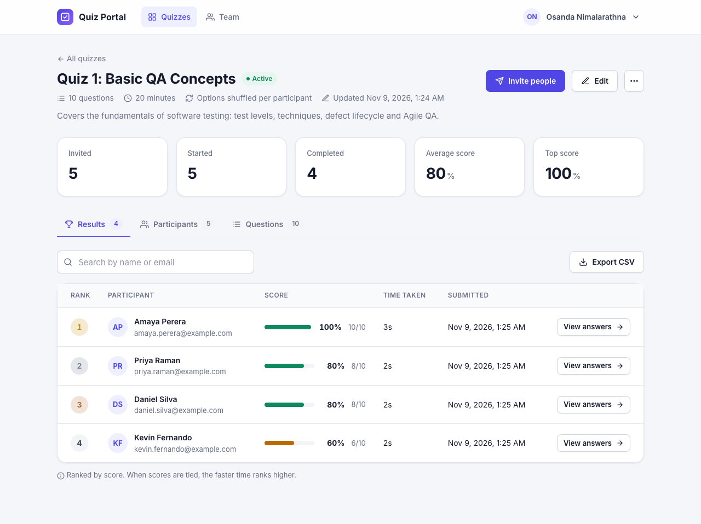

</div>

---

## Table of contents

1. [What is Quiz Portal?](#1-what-is-quiz-portal)
2. [Features](#2-features)
3. [How it works (diagrams)](#3-how-it-works)
4. [Run it on your own computer (step by step)](#4-run-it-on-your-own-computer)
5. [Admin guide: creating quizzes and reviewing results](#5-admin-guide)
6. [Participant guide: taking a quiz](#6-participant-guide)
7. [Sending invitations: no-setup sharing or automatic email](#7-sending-invitations)
8. [Put it online: Vercel or your own server (step by step)](#8-put-it-online)
9. [Updating, backups and maintenance](#9-updating-backups-and-maintenance)
10. [Troubleshooting](#10-troubleshooting)
11. [FAQ](#11-faq)
12. [Technical reference (for developers)](#12-technical-reference)
13. [License](#13-license)

---

## 1. What is Quiz Portal?

Quiz Portal is a website for running online quizzes and assessments. It has two kinds of users:

| | **Admin** (you, the organizer) | **Participant** (the person taking the quiz) |
|---|---|---|
| Signs in with | Their own admin email and password | The personal link and password they were sent |
| Can | Create quizzes, invite people, see everyone's results and answers | Take the quiz they were invited to, once, and see their own result |
| Can't | See other admins' quizzes | See any other quiz, or anyone else's answers |

A typical use: a team lead wants to check five new hires' knowledge. They create a 20-minute quiz, paste in five email addresses, and send each person a private link. When everyone has finished, they open the results to see who scored highest and which questions people got wrong.

---

## 2. Features

### For admins
- **Easy quiz builder.** Three question types:
  - **Single choice**: one correct answer (round buttons)
  - **Multiple answers**: several correct answers (tick boxes); participants must pick *all* of them
  - **Yes / No**
- **Import questions** by pasting them from a document (or from the old Markdown quiz files) instead of typing each one.
- **Time limit** per quiz (1–600 minutes).
- **Choose what participants see afterwards:** their score and the correct answers, only their score, or just a confirmation (for exams).
- **Shuffled answer options.** Each participant sees the options in a different order, so the correct answer isn't always option 1. You can switch this off per quiz.
- **Invite one person or a hundred at once.** Each person gets their **own private link** and a **different password**.
- **Share invitations for free.** Use one-click **Email** (your own email app), **WhatsApp** or **Copy**, or set up automatic email sending with a free Gmail account.
- **Ranked results.** Highest score first; ties are broken by the faster time.
- **See every answer.** Each person's choices are shown next to the correct ones.
- **Question statistics.** See how many people got each question right and which wrong answers they picked.
- **Live progress.** While someone is taking the quiz, see how many questions they've answered and how much time they have left.
- **Export to CSV** (opens in Excel or Google Sheets).
- **Manage participants.** Resend with a new password, allow a retake, or remove someone.
- **Close or reopen a quiz** at any time. **Duplicate** a quiz to reuse it.
- **Multiple admins.** Each admin's quizzes and results are **private** to them. The **owner** (the first admin) manages the team and can reset a forgotten admin password.

### For participants
- A clean, distraction-free screen that works on phones, tablets and computers.
- A **countdown timer** that starts only when they press **Start**.
- Answers **save automatically**. If the browser closes, they can reopen the link and continue.
- **Automatic submission** when time runs out, even if their browser is closed.
- A question navigator, "mark for review", and keyboard shortcuts.
- A results page with their score and the correct answers (if the admin allows it).

### Security built in
- Passwords are stored encrypted (bcrypt hashes) and are never visible again after they're created.
- **Only one browser can use a quiz link at a time.** Signing in elsewhere signs the first browser out.
- Correct answers are never sent to the participant's browser while they take the quiz.
- Protection against password guessing, form forgery (CSRF) and common web attacks.

---

## 3. How it works

### The big picture

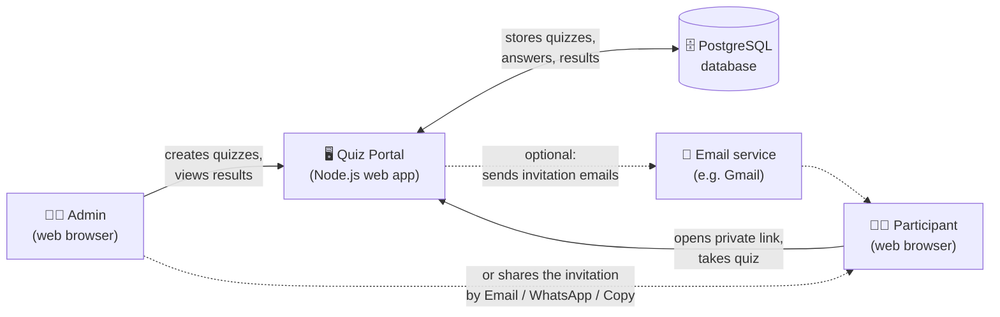

### From invitation to results

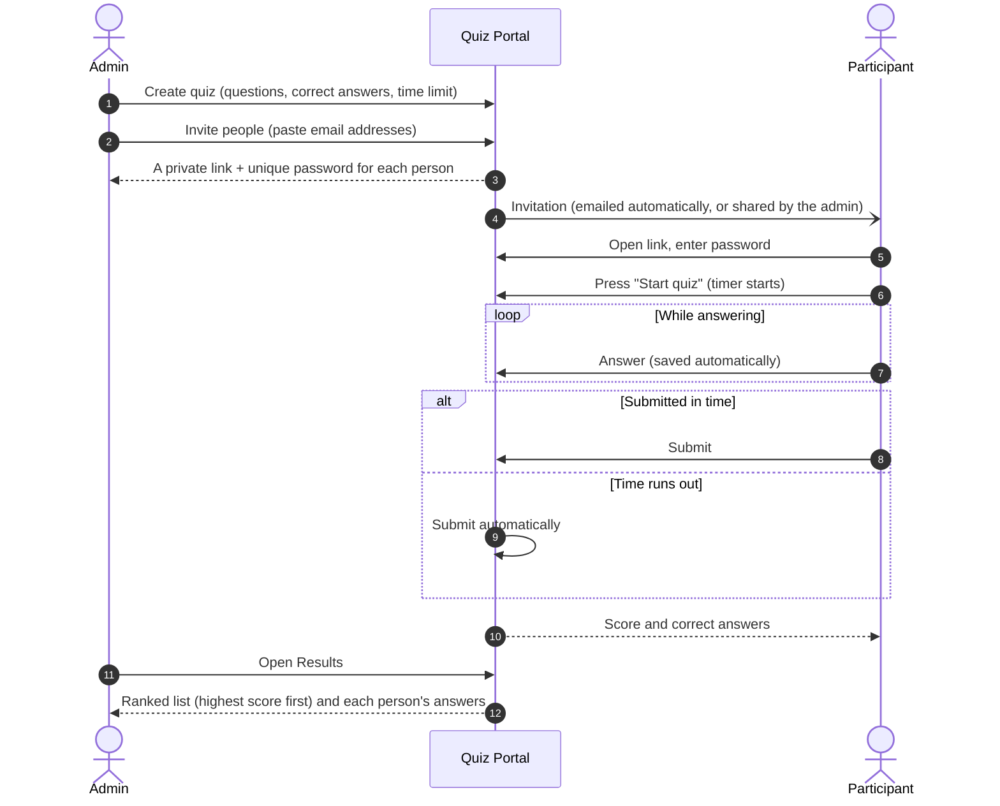

### Admin workflow

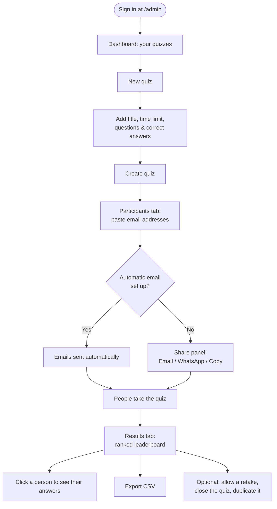

### Participant workflow

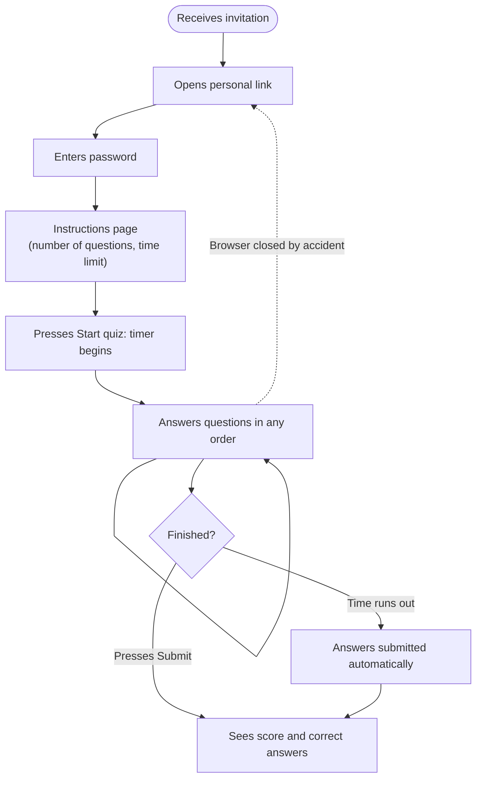

### The life of an invitation

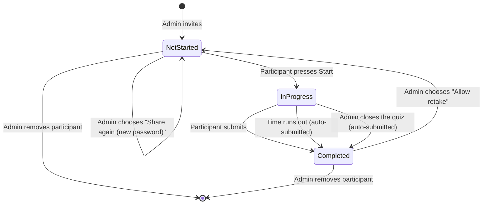

---

## 4. Run it on your own computer

This section gets Quiz Portal running on your own Windows or Mac computer, so you can try it out. It takes about **15 minutes** the first time. You don't need to know how to code; you'll copy and paste a few commands.

> **What you'll install:** two free programs.
> **Node.js** runs the app, and **Docker Desktop** runs the database it needs.

### Step 1: Install Node.js

1. Go to **https://nodejs.org**.
2. Click the big button for the **LTS** version (LTS means "long-term support", the stable version).
3. Open the downloaded file and click **Next / Continue** through the installer, keeping the default options.

### Step 2: Install Docker Desktop

1. Go to **https://www.docker.com/products/docker-desktop/** and download Docker Desktop for your computer (Windows, or Mac with Apple or Intel chip).
2. Install it, then **open Docker Desktop**. Wait until it says it's running (a green "Engine running" status at the bottom left).
3. Leave Docker Desktop open whenever you use Quiz Portal.

### Step 3: Download Quiz Portal

**Easiest way (no Git needed):**
1. Open the project's GitHub page: **https://github.com/osandadeshan/quiz-portal**
2. Click the green **Code** button, then **Download ZIP**.
3. Unzip the file. You'll get a folder; rename it to **`quiz-portal`** and move it somewhere easy to find, like your **Documents** folder.

**If you use Git:**
```bash
git clone https://github.com/osandadeshan/quiz-portal.git quiz-portal
```

### Step 4: Open a terminal in the project folder

A *terminal* is a window where you type commands.

- **Mac:** open **Finder** and find the `quiz-portal` folder. Right-click it (or hold Control and click), then choose **Services → New Terminal at Folder**. If you don't see that option, open the **Terminal** app, type `cd ` (with a space after it), drag the folder into the window, and press **Enter**.
- **Windows:** open the `quiz-portal` folder in File Explorer, click in the address bar at the top, type `cmd` and press **Enter**.

Check you're in the right place by typing `dir` (Windows) or `ls` (Mac) and pressing **Enter**. You should see files like `package.json` and `README.md`.

### Step 5: Create your settings file

Copy the example settings file. Type this and press **Enter**:

- **Mac:** `cp .env.example .env`
- **Windows:** `copy .env.example .env`

This creates a file named `.env` that holds the app's settings. The defaults work as-is on your own computer.

> 💡 Files starting with a dot are hidden on Mac. In Finder, press **Cmd + Shift + .** to show them.

### Step 6: Install the app's building blocks

```bash
npm install
```
Wait until it finishes (about a minute). Warnings are normal.

### Step 7: Start the database

```bash
docker compose up -d
```
This starts a PostgreSQL database inside Docker Desktop. The first time, it downloads it, which takes a minute or two.

### Step 8: Start Quiz Portal

```bash
npm run dev
```
When you see **`Quiz Portal running at http://localhost:3000`**, it's working. **Keep this window open** while you use the app.

### Step 9: Create your admin account

1. Open your web browser and go to **http://localhost:3000/admin**.
2. Because this is the first visit, you'll see **Create your admin account**. Enter your name, email and a password (at least 8 characters).
3. You're in. 🎉 Click **New quiz** to create your first quiz. The [Admin guide](#5-admin-guide) walks you through it.

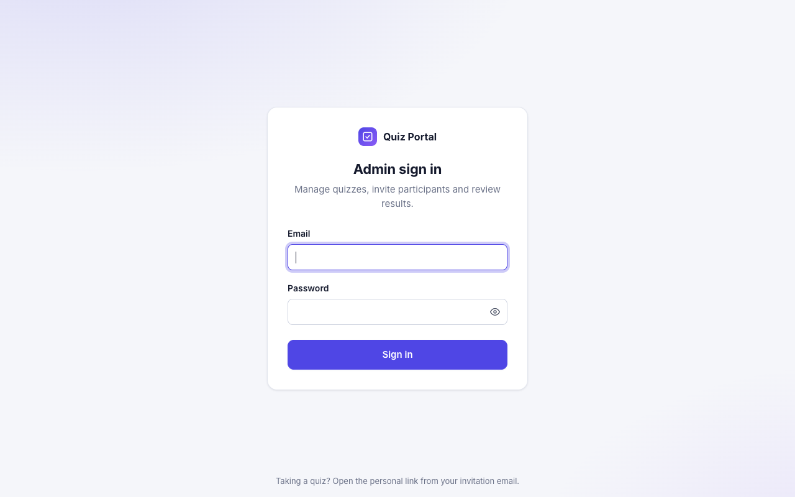

### Stopping and starting again later

- **To stop:** click the terminal window and press **Ctrl + C**. Your data stays saved.
- **To start again:** open Docker Desktop, open a terminal in the project folder, then run `docker compose up -d` and `npm run dev`.

> **Port already in use?** If another program already uses port 3000, open `.env` in a text editor and change `PORT=3000` to `PORT=3001`, and `APP_URL=http://localhost:3000` to `APP_URL=http://localhost:3001`. Then use http://localhost:3001. If the database port 5433 is taken, change `5433` in both `docker-compose.yml` and the `DATABASE_URL` line of `.env`.

---

## 5. Admin guide

### 5.1 The dashboard

After signing in you'll see all **your** quizzes, with numbers at the top for quizzes, invitations, completed attempts and average score. Use the search box or the **All / Active / Closed** buttons to find a quiz. Click any quiz card to open it.

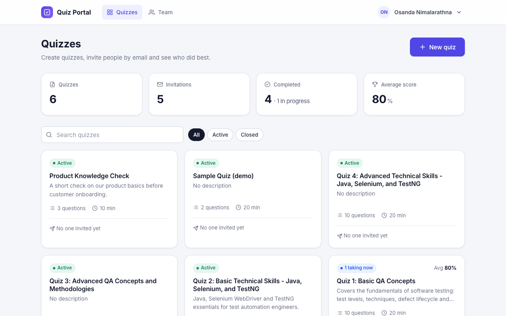

### 5.2 Create a quiz

1. Click **New quiz** (top right of the dashboard).
2. Fill in **Quiz details**:
   - **Title**: what participants will see, e.g. *"Onboarding knowledge check"*.
   - **Description** (optional): instructions or what the quiz covers.
   - **Time limit**: in minutes. When it runs out, answers are submitted automatically.
   - **Shuffle answer options**: leave this **on** so each person sees the options in a different order. Turn it off only if an option such as "All of the above" must stay last.
   - **After submitting, participants see**: pick one:
     - **Score and correct answers**: good for practice and training.
     - **Only their score**: the correct answers stay private, so you can reuse the quiz.
     - **Just a confirmation**: for exams. You share results yourself.

     You can change this at any time, even after people have started.
3. Add questions. For each question:
   1. Choose the type at the top of the card: **Single choice**, **Multiple answers** or **Yes / No**.
   2. Type the question.
   3. Type the answer options. Press **Enter** to jump to a new option line.
   4. **Mark the correct answer.** Click the circle (single choice) or square (multiple answers) next to the right option. It turns green. For Yes / No, click **Yes** or **No**.
4. Use the buttons at the bottom to add more questions. Each question card has buttons in its top-right corner to move it **up** or **down**, **duplicate** it, or **delete** it.
5. Click **Create quiz** at the bottom right (or press **Ctrl/⌘ + S**).

If something is missing, such as no correct answer marked, the question is outlined in **red** with a message saying what to fix.

**Already have your questions in a document?** Click **Import questions** (above the first question) and paste them in. Put each question on its own line with its answers below it, mark the correct answers with `[x]`, and leave a blank line between questions:

```
1. What is 2 + 2?
- [ ] 3
- [x] 4
- [ ] 5

2. Which of these are prime numbers?
- [x] 2
- [x] 3
- [ ] 4
```

The dialog tells you how many questions it found before you add them. One correct answer makes a single choice question, several make a multiple answers question, and answers that are just *Yes* and *No* become a Yes / No question. Answers can also start with `a)` or `A.`, or end with `(correct)`. Files from the older Markdown version of this app (`## 1. Question [single]`) work too. Questions with typed answers (`[text]`) are skipped, because they aren't supported. Check the imported questions, then click **Create quiz**.

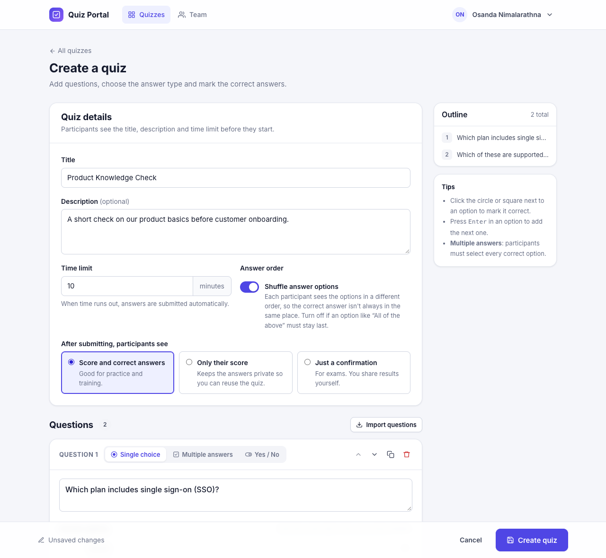

### 5.3 Invite people

1. Open the quiz and go to the **Participants** tab (or click **Invite people**).
2. In **Email addresses**, paste one address per line, or separate them with commas. You can include names like this:
   ```
   Amaya Perera <amaya@company.com>
   daniel@company.com
   ```
   Lists copied from Outlook (`Perera, Amaya <amaya@company.com>; daniel@company.com`) work too. As you type, each address shows up as a blue chip. Invalid ones show in red. You can invite up to 500 people at a time.
3. Click **Send invitations** (or **Create invitations** if automatic email isn't set up).

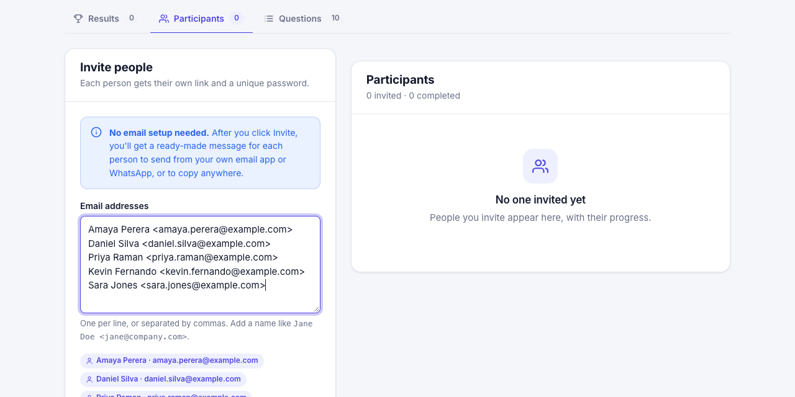

Each person gets their **own private link** and a **different password**. If automatic email is set up, they receive an email like this:

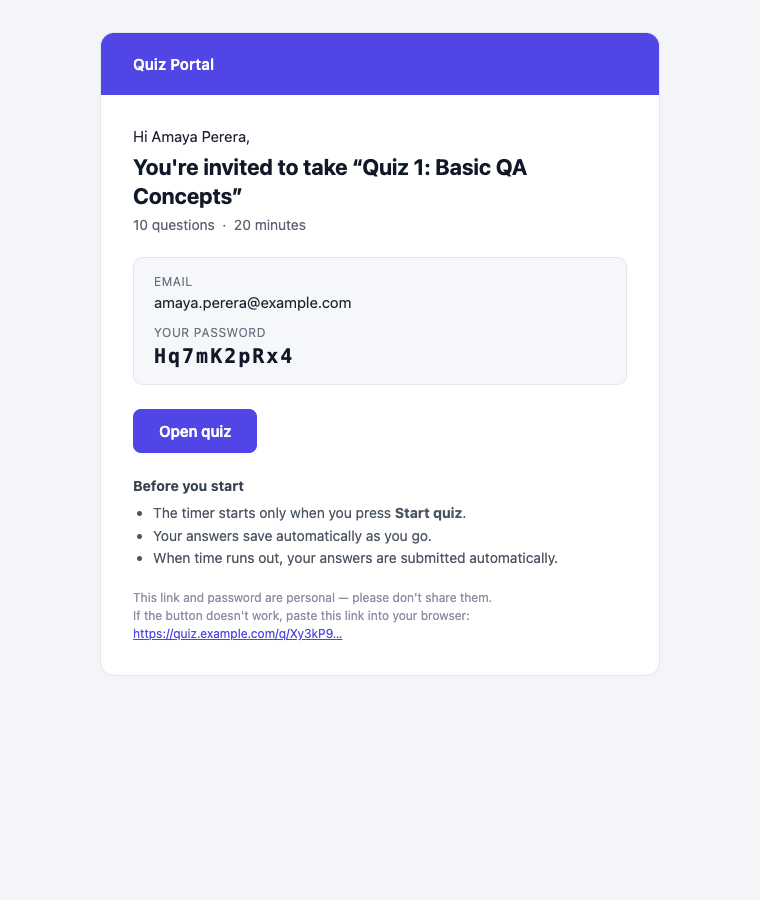

If automatic email is **not** set up, a **Share invitations** panel appears instead. For each person, click:
- **Email** to open your own email app with the invitation already written; just press Send.
- **WhatsApp** to open WhatsApp with the message ready, then choose the contact.
- **Copy message** to paste it anywhere (Slack, Teams, SMS…). **Copy all** copies everyone's at once.

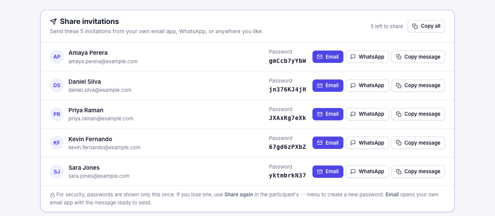

> ⚠️ **Passwords are shown only once**, for security. If you close the page before sharing, use **⋯ → Share again (new password)** next to that person.

### 5.4 Follow progress

The **Participants** tab shows everyone you invited and their status:

| Status | Meaning |
|---|---|
| **Not started** | Invited, hasn't pressed Start yet |
| **In progress** | Taking the quiz right now. Underneath you'll see how many questions they've answered and how many minutes they have left |
| **Completed · 80%** | Finished, with their score |

The small notes under each name show how the invitation went out ("Emailed", "Shared manually" or "Email failed"). An orange **"3 sign-ins"** note means the link was opened from several browsers; that can be a sign it was shared with someone else.

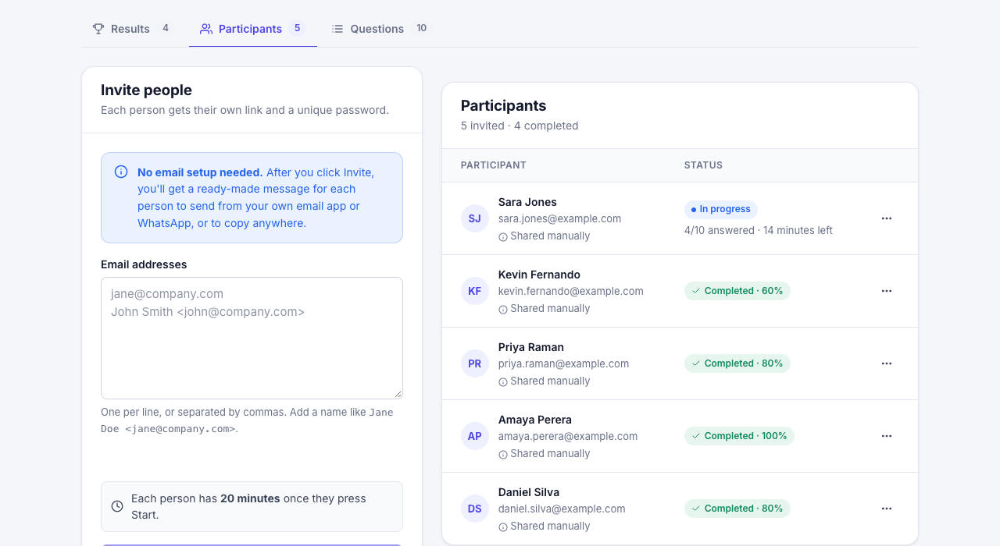

The **⋯** menu next to each person offers:
- **Resend / Share again (new password)**: creates a new password (the old one stops working). Only before they start.
- **Allow retake**: clears their answers and score so they can take the quiz again with the same link and password. For someone still taking the quiz this is called **Restart attempt**.
- **View answers**: see what they answered.
- **Remove participant**: their link stops working and their answers are deleted.

### 5.5 See the results

Open the **Results** tab. Everyone who finished is **ranked by score**, highest first. If two people have the same score, the faster one ranks higher. The top three get gold, silver and bronze badges. An **Auto-submitted** badge means their time ran out.

- Search by name or email with the search box.
- Click **Export CSV** to download the results for Excel or Google Sheets.
- Click a row or **View answers** to see that person's answers.

### 5.6 See a person's answers

You'll see their rank, score, time taken and submission time, then every question:
- ✅ green tick = they got it right, ❌ red cross = wrong, ⓘ grey = not answered
- Each option shows **Selected** (what they picked) and **Correct answer**
- Use **All / Incorrect / Correct** to filter, and the arrows at the bottom to move to the next person in the ranking.

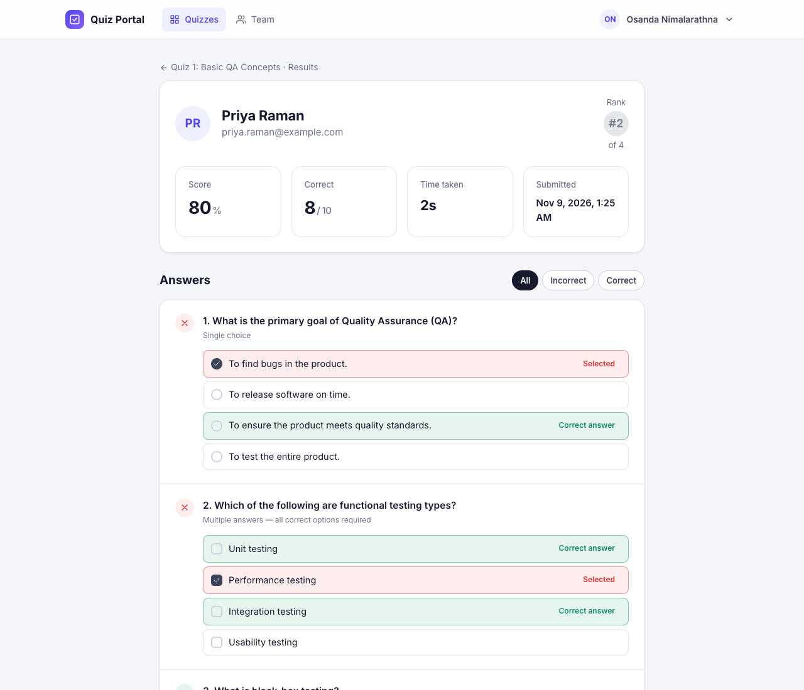

### 5.7 Which questions were hardest?

Open the **Questions** tab once people have submitted. Each question shows the **% of people who answered it correctly**, and each answer shows how many people **picked** it. A popular wrong answer usually means the question is confusing or the topic needs more training.

### 5.8 Other quiz actions (the **⋯** button next to **Edit**)

| Action | What it does |
|---|---|
| **Edit** | Change the title, description, time limit, what participants see afterwards, and the questions. *Once anyone has started, the questions are locked so everyone answers the same quiz. A new time limit applies only to people who haven't started yet.* |
| **Duplicate quiz** | Makes an editable copy, handy for reusing a quiz or changing locked questions. |
| **Close quiz** | Links stop working. Anyone mid-quiz is submitted automatically. Results stay. |
| **Reopen quiz** | Makes the links work again. |
| **Export results (CSV)** | Same as on the Results tab. |
| **Delete quiz** | Permanently deletes the quiz, invitations and answers. Can't be undone. |

### 5.9 Team (other admins) and your account

- **Team** (top menu): lists every admin. **Each admin only sees their own quizzes.**
  - The **owner** is the first admin (marked with an **Owner** badge). Only the owner can **add** admins, **remove** them, or **reset** their password. Other admins see the list but can't change it. This stops one admin from removing another to get their quizzes.
  - To add an admin: **Add admin**, enter their name, email and a temporary password (click the arrows icon to generate one), then share those details with them.
  - **⋯ → Reset password** gives that admin a new password, shown to you once. Their old password stops working and they're signed out everywhere.
  - **⋯ → Remove admin**: they can no longer sign in, and their quizzes move to you.
- **Account** (click your name, top right): change your name or password. Changing your password signs you out on every other browser.

---

## 6. Participant guide

*You can share this section with the people you invite.*

1. **Open the link** from your invitation (email, WhatsApp, etc.).
2. **Enter the password** from the same message. Passwords are case-sensitive, so copy and paste it if you can.

   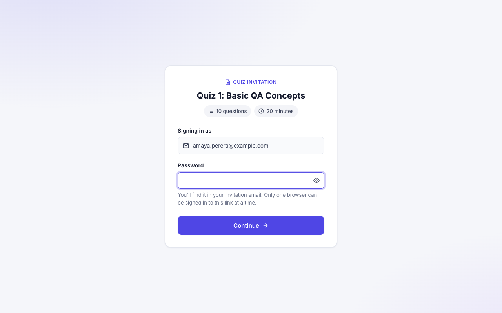

3. **Read the instructions**, which show the number of questions and the time limit. The timer **doesn't start until you press Start quiz**.

   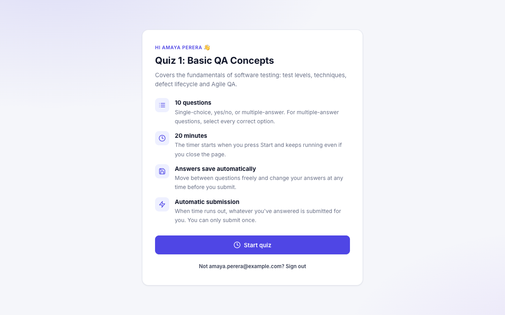

4. **Answer the questions.**
   - Click an option to choose it. For **"Select all answers that apply"** questions, tick every correct option.
   - Use **Next** / **Previous**, or click a number on the right to jump to any question.
   - Click **Mark for review** to flag a question you want to come back to.
   - The timer at the top turns orange at 5 minutes left and red at 1 minute.
   - Your answers **save automatically** ("All answers saved" at the top).

   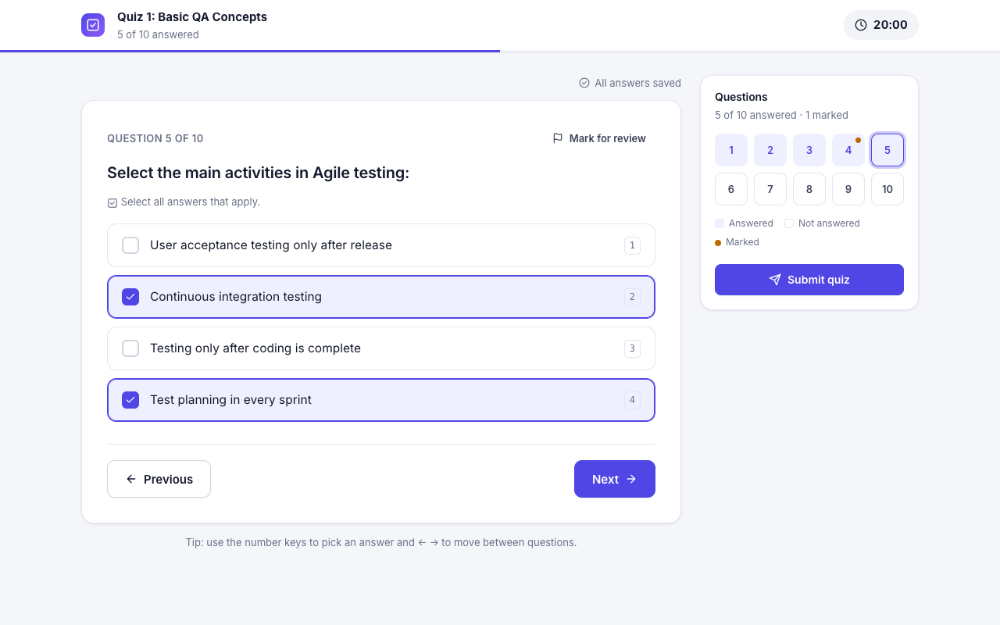

5. **Submit.** On the last question click **Review & submit** (or **Submit quiz** on the right). You'll be told if any questions are unanswered and can jump back to them.

   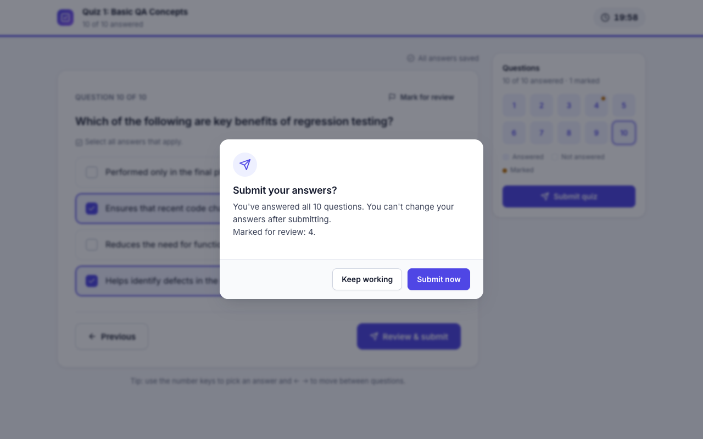

6. **See your result**: your score and each question with the correct answer.

   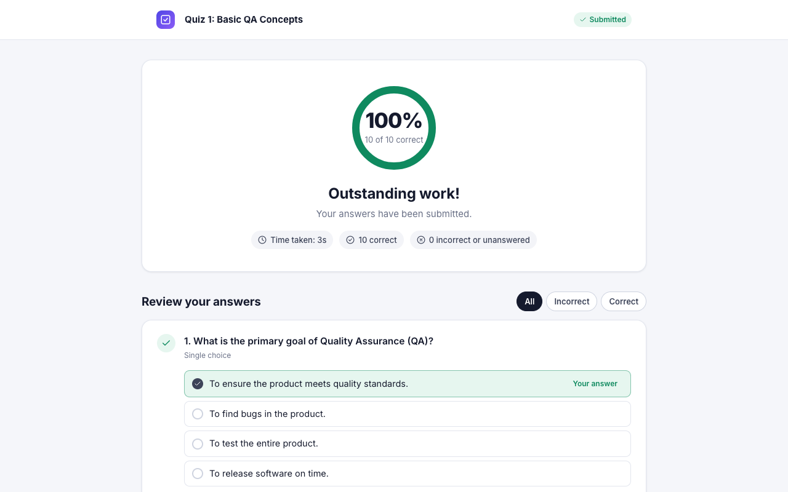

**Good to know**
- If your browser closes or your internet drops, **open the link again** and sign in. You'll continue where you left off, but **the timer keeps running**.
- When time is up, your answers are **submitted automatically**.
- You can only submit **once**.
- The link only works in **one browser at a time**. Opening it somewhere else signs out the first one.
- It works on phones too:

  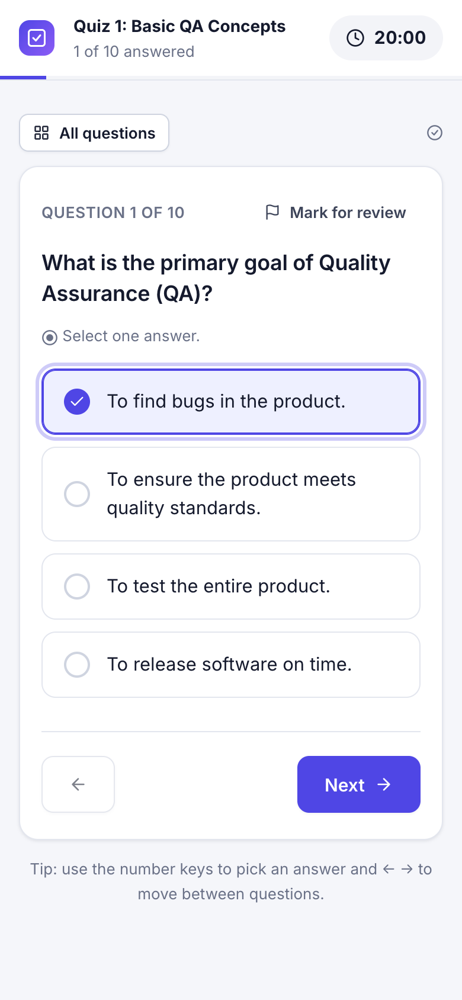

---

## 7. Sending invitations

There are two free ways. You can switch between them at any time.

### Option 1: No setup (default)

Do nothing. After inviting people, use the **Share invitations** panel ([section 5.3](#53-invite-people)) to send each invitation from your own email, WhatsApp, or by copy and paste.

### Option 2: Send emails automatically with a free Gmail account

Gmail can send around **500 emails per day** for free.

1. **Turn on 2-Step Verification** for the Gmail account you'll send from: https://myaccount.google.com/signinoptions/two-step-verification
2. **Create an App Password:** go to https://myaccount.google.com/apppasswords, type a name such as `Quiz Portal`, and click **Create**. Google shows a 16-character code. Copy it (spaces don't matter).
3. **Open your `.env` file** in a text editor (Notepad on Windows, TextEdit on Mac) and fill in these lines:
   ```
   SMTP_HOST=smtp.gmail.com
   SMTP_PORT=465
   SMTP_SECURE=true
   SMTP_USER=your.address@gmail.com
   SMTP_PASS=abcdabcdabcdabcd
   MAIL_FROM="Quiz Portal <your.address@gmail.com>"
   ```
4. **Restart Quiz Portal** (Ctrl + C, then `npm run dev`). On a cloud host, set the same values as environment variables there.
5. Invite yourself to a quiz to check it works. If an email can't be sent, that person appears in the Share panel instead, so nothing is lost.

> **Using another provider?** Any SMTP email service works, such as Outlook/Office 365, Brevo (has a free plan), Mailgun, Amazon SES or SendGrid. Copy the SMTP host, port, username and password from your provider into the same settings.
>
> **Important:** invitation links are built from `APP_URL`. On your own computer that's `http://localhost:3000`, which only works **on that computer**. To invite people on other devices, put the app online first ([section 8](#8-put-it-online)).

---

## 8. Put it online

To let people take quizzes from anywhere, the app needs to run in the cloud. Pick one option:

| Option | Cost | Difficulty | Best for |
|---|---|---|---|
| **A. Vercel + Neon** (recommended) | Free plans available | ⭐ Easiest (all in the browser, no server to look after) | Most people: small teams, schools, trying it out |
| **B. Your own server with Docker** | Usually from about $4–6/month | ⭐⭐ Some terminal use | Full control, everything on one machine |

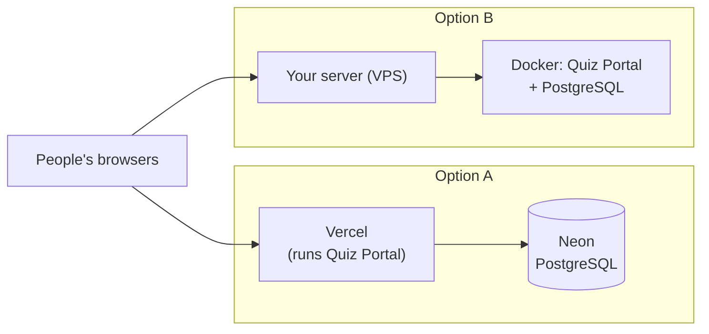

> Free plans change over time. Check each provider's pricing page for current limits before relying on them. Vercel's free **Hobby** plan is for personal, non-commercial use; a business or organisation needs a paid plan.

### Before you start (all options)

You'll need these values. Have a text file open to collect them:

| Setting | What to put |
|---|---|
| `NODE_ENV` | `production` |
| `DATABASE_URL` | The database address. On Vercel it's added for you in Part 3; for option B it's set automatically |
| `DATABASE_SSL` | `true` for Neon, `false` for option B |
| `SESSION_SECRET` | A long random string (40+ characters). Use a password generator, or run `openssl rand -hex 32` |
| `APP_URL` | The public address of your app, e.g. `https://my-quiz.vercel.app` (no slash at the end) |
| `ADMIN_EMAIL` | The email you'll sign in with |
| `ADMIN_PASSWORD` | A strong password (at least 8 characters) |
| `ADMIN_NAME` | Your name |
| `APP_TIMEZONE` | Optional. Your time zone for dates in the CSV export, e.g. `Asia/Colombo` or `Europe/London` ([list](https://en.wikipedia.org/wiki/List_of_tz_database_time_zones)). Without it, CSV times are in UTC on Vercel |
| `SMTP_*`, `MAIL_FROM` | Optional, see [section 7](#7-sending-invitations) |

> 🔒 **On a live server the "create admin" page is switched off**, so nobody else can grab it first. Your first admin is created automatically from `ADMIN_EMAIL` and `ADMIN_PASSWORD`. After signing in, you can change the password on the **Account** page.

### Option A: Vercel (app) + Neon (database)

Vercel runs Quiz Portal for you and updates it automatically whenever the code on GitHub changes. Neon stores the data. You create the Neon database from inside Vercel, so there's only one website to use.

**Part 1: Put the code on GitHub** (skip if it's already in your own GitHub account)
1. Create a free account at **https://github.com**.
2. Open **https://github.com/osandadeshan/quiz-portal** and click **Fork** (top right). This makes your own copy.

**Part 2: Create the project on Vercel**
1. Sign up at **https://vercel.com/signup** and choose **Continue with GitHub**.
2. Click **Add New…** → **Project**. Find your `quiz-portal` repository and click **Import**. If it isn't listed, click **Adjust GitHub App Permissions** and give Vercel access to it.
3. On the next screen:
   - **Project Name:** e.g. `my-quiz`. Your address will usually be `https://my-quiz.vercel.app`.
   - **Framework Preset:** leave it as **Other**. The project's `vercel.json` file already tells Vercel everything it needs.
   - Leave the build and output settings as they are.
4. Open **Environment Variables** and add each of these (type the name in the left box and the value in the right box, then click **Add**):
   ```
   NODE_ENV        = production
   DATABASE_SSL    = true
   SESSION_SECRET  = (your long random string)
   APP_URL         = https://my-quiz.vercel.app
   ADMIN_NAME      = Your Name
   ADMIN_EMAIL     = you@example.com
   ADMIN_PASSWORD  = a-strong-password
   APP_TIMEZONE    = Asia/Colombo        (optional, your own time zone)
   ```
   Add the `SMTP_*` and `MAIL_FROM` values too if you want automatic emails. You'll add `DATABASE_URL` in Part 3.
5. Click **Deploy**. The first deployment finishes in about a minute, but the app **won't work yet** because it has no database. That's expected.

**Part 3: Add the database (Neon)**
1. In your Vercel project, open the **Storage** tab and click **Create Database**.
2. Choose **Neon** (Serverless Postgres) and click **Continue**. Accept the terms and pick a plan (the free plan is fine to start).
3. Pick the **region** closest to your participants, give the database a name such as `quiz-portal`, and click **Create**.
4. When it asks which project to connect, choose your Quiz Portal project and the **Production** environment, then click **Connect**. Vercel adds `DATABASE_URL` (and a few other database variables) to your project automatically.

**Part 4: Check the address and go live**
1. Open the project's **Overview** and look at **Domains**. If the address isn't exactly the `APP_URL` you entered (for example `https://my-quiz-abc123.vercel.app`), go to **Settings** → **Environment Variables**, edit `APP_URL` to match it exactly, and save.
2. Open the **Deployments** tab, click the **⋯** next to the newest deployment, and choose **Redeploy**. This starts the app with the database and your settings.
3. Open **`https://my-quiz.vercel.app/admin`** (your own address) and sign in with your `ADMIN_EMAIL` and `ADMIN_PASSWORD`. The very first page load can take a few seconds while the database is set up. Done! 🎉

> **Tips for Vercel**
> - **Make it faster:** in **Settings** → **Functions**, set **Function Region** to the same region as your Neon database (or the closest one). Every page talks to the database, so being close matters.
> - **Your own domain:** in **Settings** → **Domains** you can add an address like `quiz.yourschool.org`. Then change `APP_URL` to it and redeploy, so invitation links use the new address.
> - **Changing a setting:** after editing any environment variable, **Redeploy** (step 2 above) so the app picks it up.
> - **Seeing errors:** the **Logs** tab shows what the app printed, including any problem connecting to the database.

### Option B: Your own server with Docker

This runs both the app and its database on one server you rent, for example from DigitalOcean, Hetzner, Linode, Vultr or AWS Lightsail. Use **Ubuntu 22.04 or 24.04** with at least **1 GB RAM**.

**Step 1: Create the server.** In your provider's dashboard, create an Ubuntu server and note its **IP address** (e.g. `203.0.113.10`) and the root password or SSH key.

**Step 2: Connect to it.** On your computer, open a terminal and type the following (use your server's IP), answering `yes` if asked:
```bash
ssh root@203.0.113.10
```

**Step 3: Install Docker** (copy and paste, then press Enter):
```bash
curl -fsSL https://get.docker.com | sh
```

**Step 4: Download Quiz Portal** (use your repository's address):
```bash
git clone https://github.com/osandadeshan/quiz-portal.git quiz-portal
cd quiz-portal
cp .env.example .env
```

**Step 5: Fill in the settings.** Open the file in the simple `nano` editor:
```bash
nano .env
```
Use the arrow keys to move and change these lines:
```
SESSION_SECRET=   (a long random string)
APP_URL=http://203.0.113.10:3000        (or https://quiz.yourdomain.com, see Step 8)
APP_TIMEZONE=Asia/Colombo               (optional: your time zone for CSV dates)
ADMIN_NAME=Your Name
ADMIN_EMAIL=you@example.com
ADMIN_PASSWORD=a-strong-password
POSTGRES_PASSWORD=   (another long random string, for the database)
APP_PORT=3000
```
You don't need to change `DATABASE_URL`; it's set automatically for this setup. Save with **Ctrl + O**, press **Enter**, then exit with **Ctrl + X**.

> Tip: create a random string with `openssl rand -hex 32`.

**Step 6: Start everything:**
```bash
docker compose -f docker-compose.prod.yml up -d --build
```
The first build takes a few minutes. Check that it's running:
```bash
docker compose -f docker-compose.prod.yml logs app
```
You should see `Created admin account for …` and `Quiz Portal running at …`.

**Step 7: Open it.** Go to `http://203.0.113.10:3000/admin` in your browser and sign in. If the page doesn't load, allow port 3000 in your provider's **firewall** settings (and on the server: `ufw allow 3000`).

**Step 8 (recommended): Use your own domain with HTTPS.**
1. At your domain registrar, add an **A record**, e.g. `quiz` → `203.0.113.10`.
2. On the server, install Caddy, a web server that sets up HTTPS certificates automatically:
   ```bash
   apt install -y caddy
   ```
3. Replace Caddy's settings with yours:
   ```bash
   echo 'quiz.yourdomain.com {
       reverse_proxy localhost:3000
   }' > /etc/caddy/Caddyfile
   systemctl reload caddy
   ```
4. Set `APP_URL=https://quiz.yourdomain.com` in `.env`, then apply it:
   ```bash
   docker compose -f docker-compose.prod.yml up -d
   ```
5. Open **https://quiz.yourdomain.com/admin**. With an `https://` address, extra protections such as secure cookies and HSTS turn on automatically.

---

## 9. Updating, backups and maintenance

### Getting the latest version
- **Vercel:** push changes to your GitHub repository's `main` branch (or click **Sync fork** on GitHub). Vercel deploys the new version automatically in about a minute. If something goes wrong, open **Deployments**, click **⋯** on the previous deployment and choose **Promote to Production** (or **Instant Rollback**) to go back.
- **Option B:**
  ```bash
  cd quiz-portal && git pull
  docker compose -f docker-compose.prod.yml up -d --build
  ```
- **Your computer:** download or pull the new code, run `npm install`, then `npm run dev`.

Database changes are applied automatically when the app starts, so you don't need to run anything by hand.

### Backups
- **Neon (Vercel):** Neon keeps restore points. Open the database from Vercel's **Storage** tab (or at **https://console.neon.tech**) to restore to an earlier time.
- **Option B:** create a backup file:
  ```bash
  docker compose -f docker-compose.prod.yml exec -T db pg_dump -U quiz quiz > backup-$(date +%F).sql
  ```
  Restore it with:
  ```bash
  docker compose -f docker-compose.prod.yml exec -T db psql -U quiz quiz < backup-2026-01-31.sql
  ```
- **Your computer:** your data lives in Docker. `docker compose stop` keeps it; `docker compose down -v` **deletes** it.

### Changing settings later
Edit `.env` and restart the app (option B), or change the environment variables in Vercel's **Settings → Environment Variables** and **Redeploy** (option A). Note that `ADMIN_EMAIL` / `ADMIN_PASSWORD` only create the **first** admin. To change your password later, use the **Account** page.

---

## 10. Troubleshooting

| Problem | Fix |
|---|---|
| `DATABASE_URL is not set` | You haven't created `.env`. Run `cp .env.example .env` (Mac) or `copy .env.example .env` (Windows). |
| `Waiting for the database…` and then an error | The database isn't running. Open Docker Desktop and run `docker compose up -d`. In the cloud, check `DATABASE_URL`. |
| `port is already allocated` / `EADDRINUSE` | Another program uses that port. See *"Port already in use?"* in [section 4](#4-run-it-on-your-own-computer). |
| `npm: command not found` | Node.js isn't installed, or the terminal was opened before installing it. Install Node.js and open a new terminal. |
| `docker: command not found` / cannot connect to Docker | Install and **open** Docker Desktop, and wait for "Engine running". |
| Participants didn't get an email | Automatic email isn't set up (check the Participants list: "Shared manually"), or it failed ("Email failed", hover for the reason). Use **⋯ → Share again**, or set up email ([section 7](#7-sending-invitations)). Also ask them to check spam. |
| Gmail: "Invalid login" / `535` | Use an **App Password**, not your normal Gmail password, and make sure 2-Step Verification is on. |
| Invitation links don't work for others | `APP_URL` is still `http://localhost…`. Put the app online and set `APP_URL` to its public address. |
| Live server says "Admin account not set up" | Set `ADMIN_EMAIL` and `ADMIN_PASSWORD` in the environment variables and restart or redeploy. |
| Can't sign in on a live server over `http://` | Make sure `APP_URL` matches the address you're using exactly (http vs https, port). |
| "Too many attempts" | Too many wrong passwords. Wait 15 minutes. |
| A participant was "signed out" | Their link was opened in another browser. They can sign in again and continue. |
| Participant lost their password | **⋯ → Share again (new password)** (only before they start). |
| Can't edit questions | Someone has already started the quiz. **Duplicate** it and edit the copy. |
| "Your session expired" / "Session expired" | The page was open for a long time, or the same form was sent twice. Reload and try again. Sign-in pages handle this by themselves: they reload with a short note, or take you straight in if you're already signed in. |
| An admin forgot their password | The **owner** opens **Team → ⋯ → Reset password** and shares the new one. |
| The owner forgot their password | Run `npm run reset-password -- you@example.com` in the project folder. On a Docker server: `docker compose -f docker-compose.prod.yml exec app npm run reset-password -- you@example.com`. It prints a new password; sign in and change it on the Account page. |
| "Only the owner … can add, remove or reset admins" | Ask the owner (the admin with the **Owner** badge on the Team page) to do it. |
| Dates in the CSV are in the wrong time zone | Set `APP_TIMEZONE` to your time zone (for example `APP_TIMEZONE=Asia/Colombo`) in `.env` and restart, or in Vercel's environment variables and redeploy. Pages already show each viewer's own time zone. |
| Vercel: “Quiz Portal can't reach its database right now” | `DATABASE_URL` is missing or wrong. In Vercel, check **Storage** (the Neon database is connected to the project's **Production** environment) and **Settings → Environment Variables**, then **Redeploy**. The **Logs** tab shows the exact error. |
| Vercel: “This Serverless Function has crashed” / `FUNCTION_INVOCATION_FAILED` | Open the **Logs** tab. `DATABASE_URL is not set` means the database isn't connected yet (Part 3 of option A). `SESSION_SECRET must be set` means that variable is missing. Fix it, then **Redeploy**. |
| Vercel: changed a setting but nothing happened | Environment variables only apply to new deployments. Open **Deployments → ⋯ → Redeploy**. |
| Vercel: the owner forgot their password | On your computer, in the project folder, run `DATABASE_URL="(copy it from Vercel → Settings → Environment Variables)" DATABASE_SSL=true npm run reset-password -- you@example.com`. It prints a new password. |

---

## 11. FAQ

**Is it really free?**
Yes. The software is free and open source (MIT license). Running it on your own computer is free, and free hosting tiers exist (Option A). You only pay if you choose paid hosting.

**How is the score calculated?**
One point per question. A **multiple-answer** question only counts as correct if the participant picks **exactly** the correct options: no missing ones, no extra ones. Unanswered questions count as incorrect.

**How are ties ranked?**
Same score → the person who finished **faster** ranks higher.

**Can participants see each other's results?**
No. Participants only see their own result. Only the admin who created the quiz sees the ranking.

**Can I stop participants from seeing the correct answers?**
Yes. In the quiz builder, under **After submitting, participants see**, choose **Only their score** or **Just a confirmation**.

**Can another admin see my quizzes?**
No. Each admin's quizzes, participants and results are private. Only the owner can remove an admin, and that admin's quizzes then move to the owner.

**What if someone forwards their invitation?**
The link and password only work for one browser at a time, and you'll see a "sign-ins" warning if a link was opened several times. The attempt always counts for the invited person.

**Does the timer stop if they close the browser?**
No. The timer runs on the server. If they don't come back in time, their saved answers are submitted automatically.

**Can I add free-text (typed) answers?**
Not currently. Questions are single choice, multiple answers, or Yes / No.

**Can I reuse a quiz?**
Yes. Use **Duplicate**. You can also invite new people to an existing quiz at any time while it's open.

---

## 12. Technical reference

### Tech stack
- **Node.js** (18+) with **Express**: server-rendered pages using **EJS** templates
- **PostgreSQL** for all data; sessions are stored in Postgres too
- Plain HTML/CSS/JS front end, with no build step and light/dark themes
- **Nodemailer** for SMTP, **bcryptjs** for password hashing, **helmet** and **express-rate-limit** for security

### Project structure
```
app.js                       Entry point (npm start / Docker)
api/index.js                 Entry point on Vercel (serverless function wrapping the same app)
vercel.json                  Vercel settings: static files from public/, everything else to api/index.js
src/
  server.js                  Express setup: security headers, sessions, routes, startup
  config.js                  Reads environment variables
  db.js, schema.sql          Database pool and schema (applied automatically at startup)
  middleware.js              CSRF, flash messages, admin auth guard, rate limits
  icons.js                   SVG icon set (also served to the browser as /js/icons.js)
  util.js                    Tokens, passwords, recipient parsing, seeded shuffle, formatting
  routes/admin.js            Admin pages: quizzes, invitations, results, team, account
  routes/take.js             Participant flow: sign-in → start → take → result
  services/quizzes.js        Quiz validation and CRUD, per-participant option order
  services/attempts.js       Invitations, sessions, answers, scoring, auto-submit sweeper
  services/admins.js         Admin accounts
  services/mailer.js         Invitation email (HTML and text) and SMTP sending
  tests/                     Playwright end-to-end tests (see "Automated tests" below)
    e2e-test-scenarios.md    Every E2E test case with baby steps and the last result (generated)
scripts/                     reset-admin-password.js
views/                       EJS templates (admin/, take/, partials/)
public/                      CSS and browser scripts (ui.js, builder.js, take.js)
docs/screenshots/            Images used in this README
docs/REVIEW.md               Latest code/QA/UX review, fixes and backlog
AGENTS.md, CLAUDE.md         Guide for AI coding agents / contributors (architecture, invariants, gotchas)
.claude/skills/              Claude Code skill: how to verify changes (runs the Playwright suite)
Dockerfile                   Production image
docker-compose.yml           Local development database (port 5433)
docker-compose.prod.yml      Production stack for your own server: app + database
.github/workflows/e2e.yml    CI: runs the Playwright suite on every pull request
LICENSE                      MIT License
```

### Data model

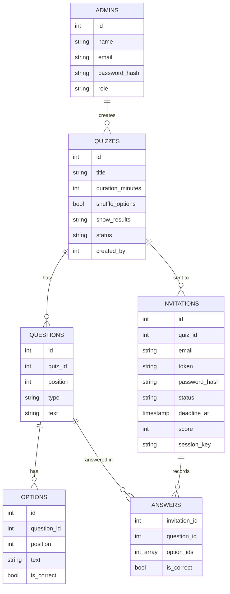

### Environment variables

| Variable | Required | Default | Description |
|---|---|---|---|
| `DATABASE_URL` | ✅ | — | PostgreSQL connection string |
| `DATABASE_SSL` | | `false` | `true` for hosted databases that need SSL |
| `SESSION_SECRET` | ✅ in production | dev value | Secret used to sign session cookies |
| `APP_URL` | ✅ online | `http://localhost:PORT` | Public URL, used in invitation links. `https://…` enables secure cookies and HSTS |
| `PORT` | | `3000` | Port the app listens on |
| `NODE_ENV` | | — | `production` on live servers (disables browser admin setup) |
| `TRUST_PROXY` | | `1` if `APP_URL` is https, otherwise off | Set only if the app is behind a reverse proxy but `APP_URL` is `http://`. Accepts `true`, `false`, a number of hops, or IP ranges |
| `APP_TIMEZONE` | | server's zone (`TZ`; UTC on Vercel) | Time zone for dates in the CSV export, e.g. `Asia/Colombo`. Pages always show each viewer's own time zone. (Vercel doesn't allow setting `TZ`, so use this.) |
| `DB_POOL_MAX` | | `10` (`3` on Vercel) | Most database connections per app instance |
| `APP_NAME` | | `Quiz Portal` | Name shown in the app and emails |
| `ADMIN_NAME` / `ADMIN_EMAIL` / `ADMIN_PASSWORD` | ✅ in production | — | Creates the first admin at startup if that email doesn't exist |
| `SMTP_HOST`, `SMTP_PORT`, `SMTP_SECURE`, `SMTP_USER`, `SMTP_PASS` | | empty | SMTP settings. Empty `SMTP_HOST` = share invitations manually |
| `MAIL_FROM` | | `SMTP_USER` | "From" address on invitation emails |
| `POSTGRES_PASSWORD`, `APP_PORT` | `docker-compose.prod.yml` only | — | Bundled database password and published port |
| `VERCEL` | set by Vercel | — | Set automatically on Vercel. Switches to serverless mode (see "Running on Vercel" below) |

### npm scripts

| Command | What it does |
|---|---|
| `npm run dev` | Start with auto-restart on code changes (development) |
| `npm start` | Start normally (production) |
| `npm run reset-password -- you@example.com` | Give an admin a new random password (when nobody can sign in) |
| `npm run test:e2e` | All automated tests (Playwright: API tests + browser tests) against a throwaway database, mailbox and app (needs Docker, about 1.5 minutes) |
| `npm run test:api` | Only the API tests (about 25 s) |
| `npm run test:ui` | Only the browser tests (about 1 minute) |
| `npm run test:e2e:headed` | Same, in a visible browser window |
| `npm run test:e2e:report` | Build and open the Allure report of the last run |
| `npm run test:e2e:doc` | Regenerate `src/tests/e2e-test-scenarios.md` without running the tests |
| `npm run test:e2e:typecheck` | Type-check the test code |

### Automated tests

Everything runs with one command, `npm run test:e2e`, which creates its own **throwaway** database, mailbox and app and never touches your real ones. There are two groups of tests:

**1. API tests** (API-01 to API-14, `npm run test:api` on their own): Playwright sends plain HTTP requests, without a browser, to check the rules a person can't easily try by clicking:
- you must sign in, and forged form posts (CSRF) are refused
- the server rejects bad quiz data
- admins can't see each other's quizzes, and only the owner manages the team
- a second device signs out the first
- scoring is all-or-nothing, and a cleared answer isn't scored from the autosave
- "just a confirmation" really hides the score
- the CSV export can't run spreadsheet formulas
- every page loads

**2. Browser tests** (E2E-01 to E2E-11, `npm run test:ui`): Playwright drives a real Chromium browser through the whole life of a quiz, just like people would:

1. The admin signs in and builds a 10-question quiz (3 single choice, 4 multiple answers, 3 Yes / No).
2. The admin invites three people by email.
3. Each person opens **their own inbox**, reads the invitation, signs in with the link and password from the email, and takes the quiz with planned answers (one gets 100%, one 70%, one 50% with an unanswered question).
4. The admin checks the ranking (1, 2, 3), every person's answers exactly as they selected them (in the order they saw them), the question statistics and the CSV export.

The inbox is **Mailpit**, a disposable mailbox that runs in Docker and catches every email the app sends, so no real emails go out. Public disposable inboxes (Mailinator, Yopmail) aren't used: anyone could read the passwords there, and they block automated browsers.

**Before the first run:** install the app's packages (`npm install`), start Docker Desktop, and install the test browser once with `npx playwright install chromium`.

**Where to find things:**

| What | Where |
|---|---|
| The overall result (**PASSED** only if every test case passed; one failure makes it **FAILED**, with the reasons), when it ran and which commit, then every test case with numbered steps a person can follow by hand, expected results, priority, component, last status, date and commit | `src/tests/e2e-test-scenarios.md` (updated automatically after every run) |
| Allure report: every step, with a full-page screenshot (browser tests) or every HTTP request and response (API tests) | `npm run test:e2e:report` (results in `src/tests/.output/allure-results`) |
| Playwright's own report, traces and videos of failures | `src/tests/.output/playwright-report`, `src/tests/.output/test-results` |
| Test code | `src/tests/e2e/`: `specs/ui` and `specs/api` (tests), `pages/` (browser page objects with all the locators), `api/` (the same for HTTP: sessions, HTML parsing, the inbox API), `flows/`, `data/`, `scenarios/` (the test cases, the single source of truth) |

**Clean-up:** the suite leaves the app exactly as it found it, whether the tests pass, fail or you stop them with Ctrl+C. Before the first test it records what's in the database and the inbox. Afterwards it deletes every quiz the run created (with its questions, invitations and answers), every extra admin, session and email, and puts the admin account back as it was (for example the last sign-in time). Then it checks every table against that record, and checks the app logged no errors. If anything is left over or an error was logged, the run fails. The throwaway containers are removed too. Look for the `[e2e-cleanup]` lines at the end of the output.

**On GitHub:** `.github/workflows/e2e.yml` runs the whole suite on every pull request and on pushes to `main`. The Allure report, Playwright report and test-case table are attached to each run as downloads ("Artifacts" on the run's page). The table also appears on the run's summary page and always shows **that run's** results: it starts empty, and the "Tested commit" column is the pull request's own commit.

The suite uses ports 3997 (app), 54331 (database), 11025 and 18025 (mailbox). Override them with `E2E_APP_PORT`, `E2E_PG_PORT`, `E2E_SMTP_PORT` and `E2E_MAIL_UI_PORT` if they're busy.

### How key behaviours work
- **Timer:** when Start is pressed, the server stores `deadline_at`. The browser only displays a countdown. A sweep (a background timer every 20 s; on Vercel, before requests, at most every 20 s) and every request auto-submit attempts past the deadline, with a 15 s grace period for the browser's final save.
- **Scoring:** all-or-nothing per question (the selected option set must equal the correct set).
- **Ranking:** `RANK() OVER (ORDER BY score DESC, time_taken ASC)`.
- **One browser per link:** each sign-in stores a new random `session_key` on the invitation, and older browsers' keys stop matching. The quiz page polls `/q/:token/ping` every 15 s.
- **Option shuffling:** a deterministic shuffle seeded by the invitation token and question ID, so the order is stable for each person and nothing needs storing.
- **Privacy between admins:** every admin query is scoped by `quizzes.created_by`. Only the owner (`admins.role = 'owner'`) can manage other admins.
- **Running on Vercel:** `vercel.json` serves `public/` from Vercel's CDN and sends every other request to one serverless function, `api/index.js`, which wraps the same Express app. Vercel sets `VERCEL=1`, and the app then:
  - runs its startup work (database schema, first admin) on the first request of each instance, not at boot. Instances take turns applying the schema, using a database lock.
  - has no background timer: expired attempts are finalized before a request, at most every 20 s per instance (and as always, when that participant's page is loaded or the quiz is submitted)
  - uses a small database pool (`DB_POOL_MAX`, 3) and no SMTP connection pooling
  - The test suite can run the app this way (`E2E_TARGET=vercel npm run test:e2e`).
- **Health check:** `GET /healthz` returns `{"ok":true}` when the app can reach the database. `docker-compose.prod.yml` uses it, and you can point a hosting platform's health check at it.

---

## 13. License

Released under the **MIT License**: free to use, modify and share. See [LICENSE](LICENSE).
